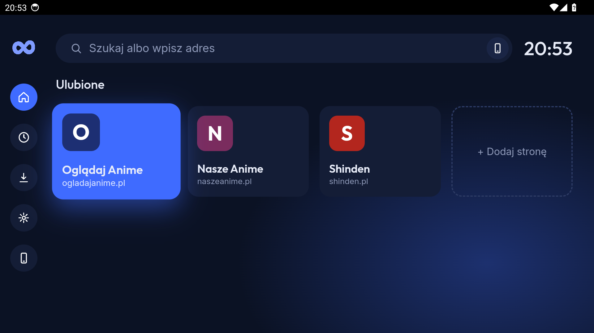
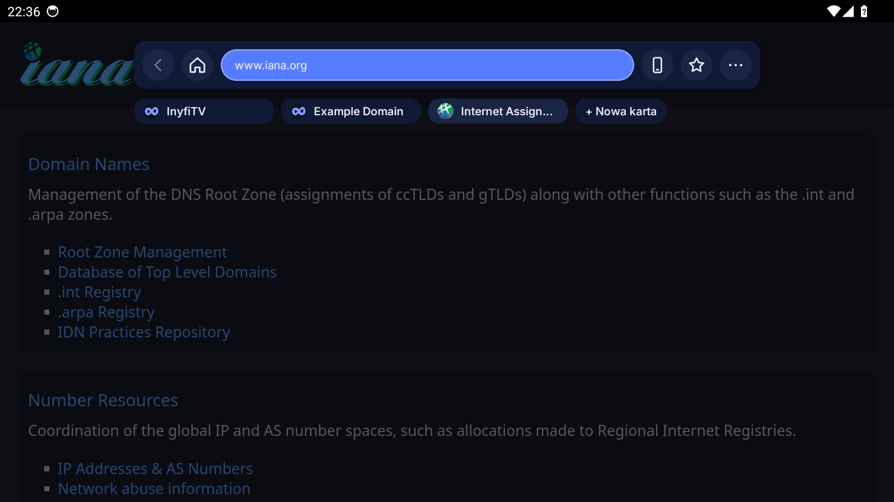
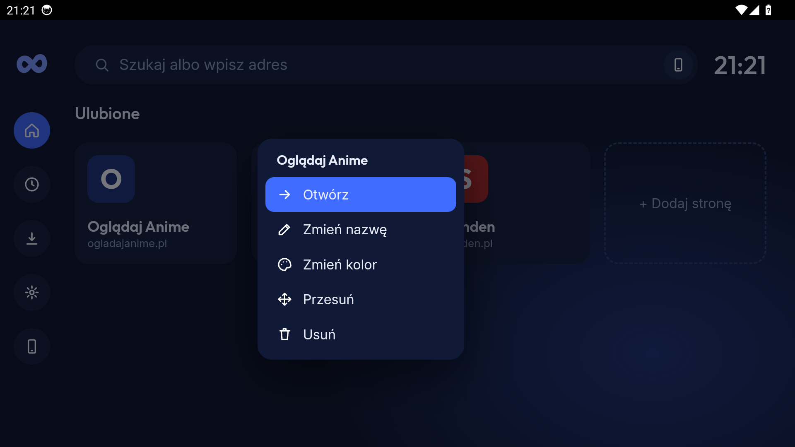
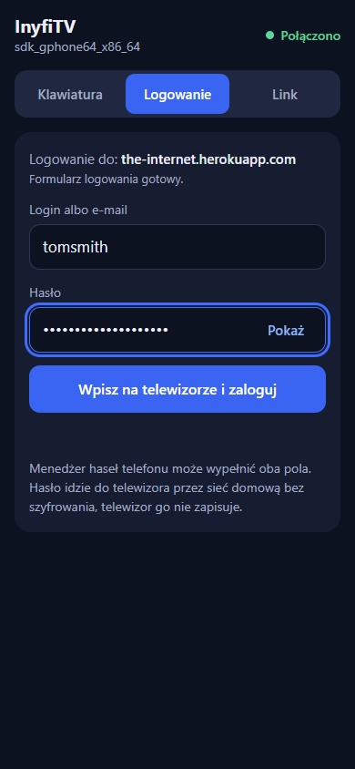
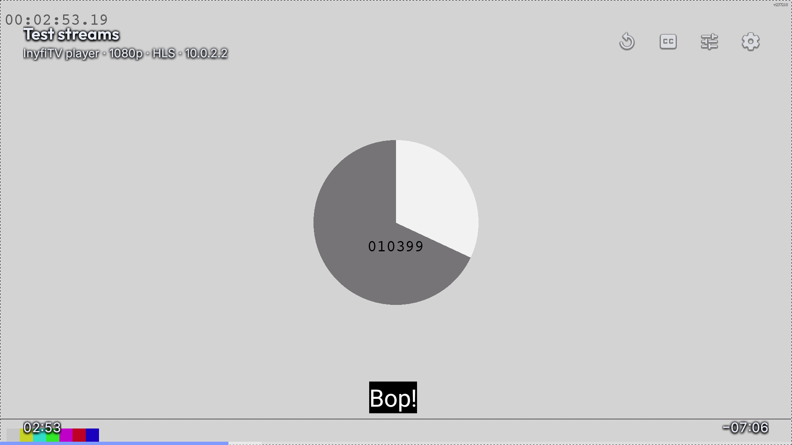

# InyfiTV

InyfiTV to przeglądarka internetowa na Android TV, stworzona z myślą o wygodnym oglądaniu filmów i seriali oraz obsłudze za pomocą pilota.

**[Pobierz InyfiTV 2.0.10 (APK)](https://github.com/inyfinn/InyfiTV/releases/download/v2.0.14/InyfiTV.apk)** · [Wszystkie wydania](https://github.com/inyfinn/InyfiTV/releases)

## Najważniejsze funkcje

- Ciemny interfejs dostosowany do ekranów telewizorów.
- Ulubione strony w formie konfigurowalnych kafelków.
- Zmiana nazw, kolorów i kolejności zakładek.
- Sekcja „Oglądaj dalej” z ręcznie dodawanymi stronami.
- Wbudowany odtwarzacz z trzema motywami; przewijanie o 10 sekund bez zasłaniania napisów.
- Blokowanie reklam, wyskakujących okien i przekierowań z osadzonych odtwarzaczy.
- „Otwórz w odtwarzaczu InyfiTV” z menu strony (przytrzymaj OK).
- Trzy tryby sterowania: kursor, hybrydowy (kursor przyciągany do przycisków) i kafelkowy.
- Kursor z regulacją wyglądu, rozmiaru i prędkości; przewijanie przy krawędzi ekranu.
- Pytania wyświetlane przez strony obsługiwane strzałkami i OK.
- Pływający pasek nawigacyjny przeglądarki.
- Wpisywanie tekstu, adresów i danych logowania z telefonu.
- Historia przeglądania i obsługa kart.
- Aktualizacje bezpośrednio z poziomu aplikacji.

## Przeglądanie stron

Pływający pasek zapewnia dostęp do najważniejszych funkcji przeglądarki bez konieczności opuszczania aktualnie otwartej strony.

## Personalizacja ekranu startowego

Przytrzymaj OK na wybranym kafelku, aby zmienić jego nazwę, kolor, pozycję lub usunąć go z ekranu startowego.

## Telefon zamiast klawiatury

Nie musisz wpisywać długich adresów ani danych logowania za pomocą pilota.

1. Połącz telefon i telewizor z tą samą siecią domową.
2. Wybierz ikonę telefonu na pasku przeglądarki.
3. Zeskanuj wyświetlony kod QR.
4. Korzystaj z klawiatury telefonu, przesyłaj linki lub uzupełniaj dane logowania.

Połączenie nie wymaga zewnętrznego serwera ani instalowania dodatkowej aplikacji na telefonie.

> **Uwaga:** w obecnej wersji komunikacja między telefonem a telewizorem nie jest szyfrowana. Korzystaj z niej tylko w zaufanej sieci domowej.

## Odtwarzacz

Motyw „Krawędź”: cienki pasek przy dolnej krawędzi, bez przyciemniania obrazu. Dostępne są też motywy „Cień” i „Kapsuła”.

## Instalacja

InyfiTV jest dostępne jako plik APK instalowany poza sklepem Google Play.

1. Przejdź do sekcji [Releases](https://github.com/inyfinn/InyfiTV/releases).
2. Pobierz plik `InyfiTV.apk` z najnowszego wydania.
3. Przenieś plik na urządzenie z Android TV.
4. Zezwól na instalowanie aplikacji z danego źródła.
5. Zainstaluj i uruchom InyfiTV.

Kolejne aktualizacje aplikacja pobiera samodzielnie i prosi o potwierdzenie instalacji.

## W przygotowaniu

- Następny i poprzedni odcinek w odtwarzaczu.
- Automatyczne „Oglądaj dalej”.
- Tryb oszczędny dla stron odtwarzających filmy w tle.

## Status projektu

InyfiTV jest obecnie w fazie beta i jest aktywnie rozwijane. Niektóre strony internetowe mogą działać nieprawidłowo ze względu na zastosowane przez nie zabezpieczenia lub wymagania techniczne.

To repozytorium służy do publikowania wydań aplikacji i aktualizacji.

## Zgłaszanie błędów

Problemy oraz sugestie dotyczące nowych funkcji można zgłaszać w sekcji [Issues](https://github.com/inyfinn/InyfiTV/issues).

W przypadku błędu warto podać model telewizora, wersję Android TV, wersję aplikacji oraz opis problemu.

## Licencja i pochodzenie

InyfiTV powstało na bazie otwartego projektu [TV Bro](https://github.com/truefedex/tv-bro), z zachowaniem warunków jego licencji.
